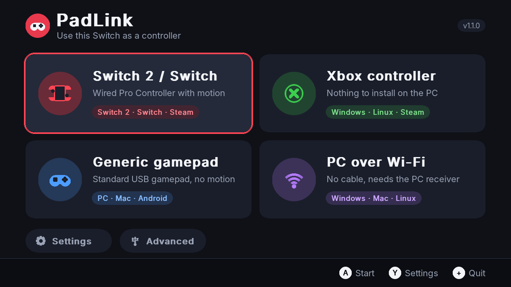
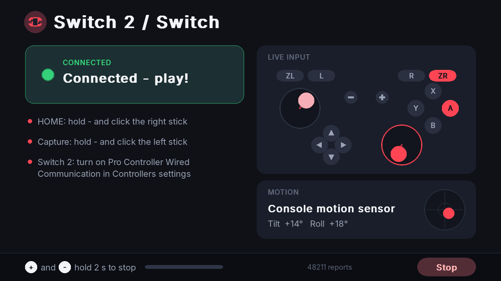

<p align="center"></p>

<h1 align="center">PadLink</h1>
<p align="center">Turn a modded Nintendo Switch into a USB controller for a <b>Switch 2</b>, a Switch, or a <b>PC</b>.<br>
Use your Hori Split Pad Pro or Joy-Cons, with motion controls.</p>

<p align="center"></p>

---

## What it does

| Plug into | Shows up as | Needs on the other side |
|---|---|---|
| **Switch 2 / Switch** | Wired Pro Controller, with motion | "Pro Controller Wired Communication" turned on |
| **Windows / Linux PC** | Xbox controller | Nothing |
| **Steam (any PC)** | Pro Controller, with motion | Nothing |
| **Mac or anything else** | Generic USB gamepad | Nothing |
| **PC over Wi-Fi** | Xbox controller | The small PadLink PC receiver |

## Install (2 minutes)

1. Download **`PadLink-sd.zip`** from the [latest release](../../releases/latest).
2. Unzip it to the **root of your SD card**. That gives you `switch/padlink/padlink.nro`.
   - No card reader? Use DBI's *Run MTP responder* (with OpenMTP on a Mac), copy the `switch` folder over, then **close DBI completely**.
3. On the Switch, **hold R while starting any game**. The homebrew menu opens. Pick **PadLink**.

You need a Switch running Atmosphère (tested on firmware 16.0.2, Atmosphère 1.11.1).

## Use it

1. Pick what you're plugging into: tap a card or use the D-pad and **A**.
2. Connect a USB-C cable from the Switch to the other device.
3. Play. The screen turns green and shows **Connected**, with your buttons, sticks and tilt live on screen.

<p align="center"></p>

| | |
|---|---|
| **Stop** | Hold **+** and **–** together for 2 seconds, or tap **Stop** |
| **HOME** | Hold **–** and click the **right stick** |
| **Capture** | Hold **–** and click the **left stick** |
| **Motion** | Keep the Switch still for 1.5 s after starting. With a Split Pad Pro (it has no motion sensor) PadLink uses the console's own sensor, so you tilt the whole Switch. |

Everything else (motion source, tilt direction, gyro sensitivity, latency, Xbox button layout, start automatically) is under **Settings** in the app.

### Switch 2 setup (once)
On the Switch 2: **System Settings › Controllers & Accessories › Pro Controller Wired Communication › On.**

### Wi-Fi mode (optional)
Download **`PadLink-PC-receiver.zip`**, install Python 3, then run:
```
pip install vgamepad          # Windows (also install ViGEmBus)
python padlink_receiver.py
```
Then pick **PC – Wi-Fi** on the Switch. Both need to be on the same network.

## Troubleshooting

| Problem | Fix |
|---|---|
| "Couldn't start" | Close DBI, Goldleaf, Tinfoil or anything else that uses the Switch's USB port, then try again. |
| Switch 2 doesn't react | Check that Pro Controller Wired Communication is on. Unplug and plug the cable back in. |
| Tilt goes the wrong way | Settings › Tilt axis X / Y / Z › Inverted. |
| Something acts up | Settings › Latency › Standard. |
| It crashed | Send `switch/padlink/padlink.log` and the newest file in `atmosphere/crash_reports/` with your issue. |

Don't press the Switch's own HOME button while playing: it pauses PadLink.

## Build it yourself

With [devkitPro](https://devkitpro.org/wiki/Getting_Started) (`switch-dev`) installed:
```
git clone https://github.com/<you>/PadLink && cd PadLink
make
```
Every push builds automatically on GitHub Actions. Pushing a tag like `v1.0.0` publishes a release with the zips.

## How it works

PadLink runs as a normal homebrew app (not a background sysmodule), so it can't break your other sysmodules and it's gone once you quit. It uses the Switch's USB-device mode (`usb:ds`) to present a standard controller: the Pro Controller USB protocol, XInput, or USB HID. Wi-Fi mode only uses normal network sockets.

*Not affiliated with Nintendo or Microsoft. Use at your own risk.*

MIT License.
